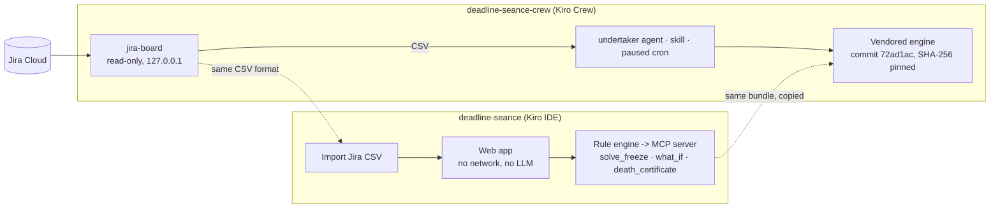

# Deadline Séance Crew

A [Kiro Crew](https://kiro.dev/docs/crew/apps/) app for Kiroween 2026. It brings the Deadline Séance rule into Crew, fed with the live open issues of a Jira Cloud project.

This app is the Kiro Crew companion of Deadline Séance, built for the Kiroween 2026 "Best Kiro Crew App" bonus. Main repository: [hvaler/deadline-seance](https://github.com/hvaler/deadline-seance). Live web app: [hvaler.github.io/deadline-seance](https://hvaler.github.io/deadline-seance/). Demo video: [youtu.be/Vn5QPBWRCSQ](https://youtu.be/Vn5QPBWRCSQ).

## How it relates to Deadline Séance

This app runs the main repo's engine unchanged, fed with live Jira issues in the same CSV format the web app imports; the main repo does not depend on this one.



Ask the **undertaker** agent things like *"what happens to Friday's cut if Ana is away?"*. It reads the board from Jira, asks Deadline Séance's `what_if`, and answers only with numbers the tools returned:

> Ana away all week: capacity 59 -> 39, tickets kept 12 -> 9, cost of delay 167 -> 124. Out: HB-13, HB-15, HB-18.

## What is inside

| Part | What it does |
|---|---|
| `jira-board` MCP server (`mcp/jira-board/`) | One read-only tool, `jira_board_csv`: the open issues of one project as the Jira CSV Deadline Séance imports. Node, no dependencies. **You start it in your own terminal** (below); Crew reaches it at `http://127.0.0.1:47821/mcp`. |
| `deadline-seance` MCP server (`vendor/deadline-seance-mcp.mjs`) | The Deadline Séance server, vendored unchanged: `solve_freeze`, `what_if`, `death_certificate`. See `vendor/README.md`. |
| `undertaker` agent, `deadline-seance` skill | Calls `jira_board_csv`, then a Deadline Séance tool. States only returned numbers. |
| `nightly-certificate` job | Weekdays 20:00 Europe/Madrid, writes tonight's death certificate. **Ships paused.** |

## Needs

- Kiro Crew 0.12 or later, on Windows, macOS or Linux.
- Node.js 22 or later on `PATH`.
- A Jira Cloud site and an [API token](https://id.atlassian.com/manage-profile/security/api-tokens).

## Install

1. In Crew: **Apps -> Library -> Install from local path**, pick this folder. Or `kirocrew app install <path>`.
2. Trust and enable it from the App Store prompt. Crew asks because the app starts a local program (the Deadline Séance server).

## Start the Jira reader

Run this in your own terminal, from this folder, and leave it open:

```
npm run jira-board
```

It prints one line, for example:

```
jira-board listening on http://127.0.0.1:47821/mcp (JIRA_BASE_URL present, JIRA_EMAIL present, JIRA_API_TOKEN present)
```

**Why outside Crew:** Crew deliberately keeps Jira credentials away from app processes. It removes `JIRA_API_TOKEN` from the environment of everything it starts. So the reader runs in your terminal, with your environment, and Crew only talks to it over HTTP. The Jira token never passes through Crew.

How it is protected:
- It listens on `127.0.0.1` only, never on the network.
- It refuses any request whose `Host` or `Origin` is not `127.0.0.1` or `localhost`. This blocks web pages that try a DNS-rebinding trick.
- Every request needs a **local token**, a random value that is not the Jira token. It is made on first start in `%APPDATA%\deadline-seance-crew\local-token` (Windows) or `~/.config/deadline-seance-crew/local-token`, readable only by you.
- It prints nothing else. No credential, no token, no Jira data.

Give Crew the local token once. Crew sends it as `Authorization: Bearer ${env:DSC_JIRA_BOARD_TOKEN}`; the value lives in Crew's own `.env`, never in this repo. In PowerShell, after the first start:

```powershell
$t = (Get-Content "$env:APPDATA\deadline-seance-crew\local-token" -Raw).Trim()
Add-Content -Path "$env:USERPROFILE\.kiro\crew\.env" -Value "DSC_JIRA_BOARD_TOKEN=$t"
Remove-Variable t
```

Then restart Crew. To use another port, set `DSC_JIRA_BOARD_PORT` before `npm run jira-board`, and change the port in `app.json`'s `jira-board` url to match.

## Jira setup

1. In the terminal that runs the reader, have three variables:
   - `JIRA_BASE_URL`, like `https://<your-site>.atlassian.net`
   - `JIRA_EMAIL`, the account the token belongs to
   - `JIRA_API_TOKEN`
   They are read only by `jira-board`. They are never logged, stored or returned.
2. In the project, on the Story issue type, have these **number** fields: `Story point estimate`, `Value`, `Urgency`, `Risk`, `Times Postponed`. `Cost of Delay` is optional: use it instead of Value, Urgency and Risk for a ticket. Value, Urgency and Risk take 1, 2, 3, 5, 8, 13 or 20.
3. Mark must-haves with the label `must-have`. Mark dependencies with **Blocks** links.
4. Check the setup by asking the undertaker to run `jira_board_csv` with `check: "setup"`. It reports the project's HTTP status and which field names exist, and nothing else.

Want demo data? `node scripts/seed-jira.mjs` checks an **empty** project and prints a plan. `node scripts/seed-jira.mjs --yes` creates Deadline Séance's 19 sample tickets in it (keys HB-1 to HB-19). If the tickets exist and only the 5 Blocks links are missing, `node scripts/seed-jira.mjs --links-only` shows which links it would add (dry run). `--links-only --yes` creates only the missing ones. It matches the sample to the existing issues by summary and refuses if one is missing or duplicated. It also refuses, and creates nothing, if a Blocks link already runs the wrong way. Run it from your own terminal.

### How Jira maps to the CSV

| CSV column | From Jira |
|---|---|
| Issue key, Summary | key, summary |
| Story Points | Story point estimate |
| Value, Urgency, Risk, Cost of Delay, Times Postponed | the number fields of the same name |
| Must Have | `yes` when the label `must-have` is set |
| Depends On | the "is blocked by" ends of Blocks links, to other open issues |
| Fix Version/s | the fix versions (Deadline Séance does not read this column) |
| Resolution | empty: only open issues are read (status category not Done) |

## Examples

- "What happens to Friday's cut if Ana is away?"
- "And if Ana is only away Wednesday afternoon?"
- "What does the cut keep if we exhume HB-18?"
- "Write tonight's death certificate."

To turn on the nightly job: **Schedule**, find `nightly-certificate`, resume it.

## Security

- `jira_board_csv` only reads: `GET /rest/api/3/field` and `POST /rest/api/3/search/jql`.
- It asks only for summary, labels, links, fix versions and the number fields. It asks for no people fields.
- Credentials come only from the environment of the terminal that runs `jira-board`. Errors say which variable is missing, never its value, and never the site URL.
- The HTTP server listens on 127.0.0.1 only, checks `Host` and `Origin`, and needs the local bearer token.
- `scripts/seed-jira.mjs` writes to Jira only with `--yes`. The seed needs an empty project. `--links-only` only adds missing Blocks links. Neither edits or deletes.

## Limits

- At most 60 open issues per board (Deadline Séance's limit). Use `fixVersion` to narrow.
- One project per call. Jira Cloud only.
- The team (names, points per half-day) is Deadline Séance's sample team. Jira has no team data here.
- Who is away comes only from the question.

## Tests

```
npm test
```

Uses `node:test` and no network. Recorded Jira answers live in `tests/fixtures/`: an invented site (`example.atlassian.net`), invented ids, and the 19 sample tickets. One test sends the produced CSV to the vendored Deadline Séance server and checks the sample's numbers. The HTTP tests run the server on a free port of 127.0.0.1 with a test token.

## Licence

MIT. See `LICENSE`.
